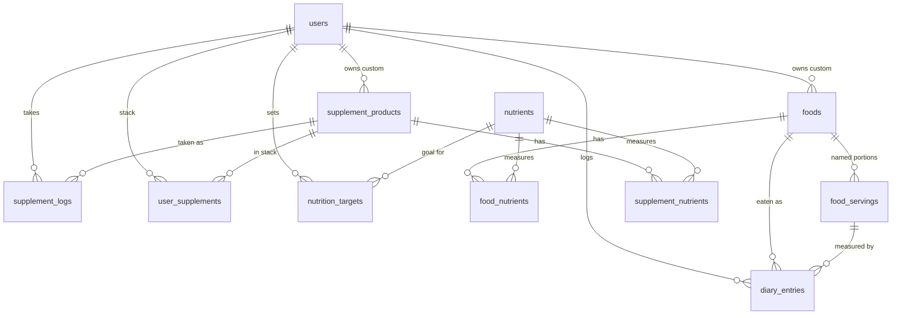

# Data model

Source of truth: [`src/db/schema.ts`](../src/db/schema.ts). Migrations live in
[`drizzle/`](../drizzle).

## Tables

| Table | Purpose |
| --- | --- |
| `users` | Account, timezone, unit system, sex / birth date / height (for future personalised targets) |
| `nutrients` | Catalogue of trackable nutrients, seeded from `nutrient-catalog.ts` |
| `foods` | Foods. `owner_id` null = shared/imported, set = a user's custom food |
| `food_nutrients` | Nutrient amounts **per 100 g** |
| `food_servings` | Named portions with a gram weight; at most one default per food |
| `diary_entries` | One logged food: date, meal, quantity, resolved grams |
| `supplement_products` | A supplement and its serving label ("1 capsule") |
| `supplement_nutrients` | Nutrient amounts **per serving** |
| `user_supplements` | A user's regular stack (servings per dose, timing, active) |
| `supplement_logs` | One dose taken |
| `nutrition_targets` | A user's per-nutrient daily target and optional upper limit |

## Decisions baked into the schema

- **Foods per 100 g, supplements per serving.** Food data sources (USDA, Open Food Facts) are
  per 100 g. A capsule has no meaningful gram weight, so supplements use per-serving amounts.
  Both feed the same `nutrients` catalogue, so they add up directly.
- **`entry_date` is a local calendar `date`**, not a timestamp, so "today" means the user's
  today. `logged_at` / `taken_at` record the real instant.
- **Diary rows store resolved `grams`.** Editing or deleting a serving later does not change
  what you logged. Nutrient values are still looked up live, so correcting a food's data
  corrects history too, which is how Cronometer behaves.
- **Doubles for amounts.** Nutrient data is measured, not money, so `double precision` is fine
  and avoids string conversion in JS.
- **Check constraints** keep amounts non-negative and quantities/grams positive.
